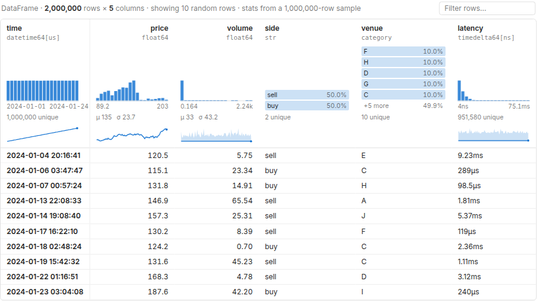

# rundown
A quick, good-looking overview of a pandas or polars DataFrame for notebooks (and Dash).

## Installation

`pip install rundown`

## Usage

In Jupyter (Lab, Notebook or VS Code), or anywhere else that renders HTML:

```python
import pandas as pd
import seaborn as sns
import rundown

titanic = sns.load_dataset("titanic")
titanic.rundown()
```


Every column gets a **margin viz** above it: a histogram for numbers, dates and durations, or its top values for categories, text, booleans and low-cardinality numbers. Underneath are the null rate and a few key stats (hover over a bar for exact counts), then a sample of rows. The header stays put while you scroll. Click a column name to sort the rows, or type in the filter box.

It's plain HTML and inline SVG (no matplotlib, no JavaScript dependencies), so it's fast and small. A 5-million-row frame renders in about 2 seconds as ~45 KB of HTML. On frames with more than `max_profile_rows` rows (1M by default), stats come from a random sample.

### Sparklines

`sparklines=True` adds a sparkline under each numeric, datetime and boolean column, plotting its values in row order. It helps with time series and with spotting sorting, drift or gaps. Long columns are downsampled to min/mean/max buckets, so the shape survives at any size.

```python
ticks.rundown(sparklines=True)
```



### Options

```python
df.rundown(
    n=10,                    # rows to show
    sample="random",         # "random" (kept in order), "head" or "tail"
    sparklines=False,
    max_columns=50,          # None for all
    max_height="480px",      # the table scrolls inside this height
    max_chars=40,            # longer cell text is truncated (full text on hover)
    bins=20,
    top_k=5,                 # top values shown for categorical columns
    max_profile_rows=1_000_000,
    random_state=None,
)
```

`pd.Series.rundown()` works too. The result displays itself in a notebook; use `.to_html()` or `.save("rundown.html")` to use it elsewhere.

### polars

`import rundown` also adds `.rundown()` to polars DataFrames and Series when polars is installed. Headers show polars dtypes (`i64`, `str`, ...). pyarrow isn't needed. Only the first `max_columns` columns are converted for profiling. Call `.collect()` on a LazyFrame first.

```python
import polars as pl
pl.read_parquet("trips.parquet").rundown(sparklines=True)
```

Other frames work through the plain function `rundown.rundown(obj)` if they have a `to_pandas()` method or support the Arrow PyCapsule interface (pandas 3, needs pyarrow).

### Dash

No custom component is needed. `.to_dash()` returns an `html.Iframe` that sizes itself to its content, with sorting and filtering still working:

```python
from dash import Dash, html
app = Dash()
app.layout = html.Div([df.rundown(sparklines=True).to_dash(id="summary")])
```

Inside the iframe it uses the light theme, because the notebook theme variables don't reach it.

## Development

```bash
uv sync
uv run pytest
```

## Releasing

[The Release workflow](.github/workflows/release.yml) publishes to PyPI based on the version in `pyproject.toml`. It needs a `PYPI_API_TOKEN` Actions secret.

- **Merge to `main`:** if that version isn't tagged yet, it's published to PyPI and tagged (`v<version>`) with a GitHub release. To release, bump the version (`uv version --bump patch`) and merge to `main`.
- **Merge to `develop`:** a dev pre-release `<version>.dev<N>` is published (N is the workflow run number). If the version is already released, dev builds count towards the next patch version. Install one with `pip install --pre rundown`.
