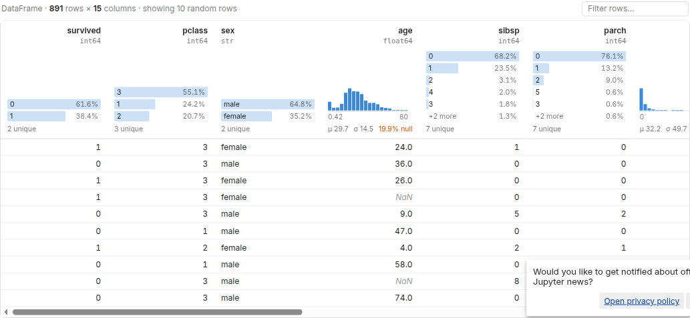

# rundown
A fun addition to pandas?

## Installation

`pip install rundown`

## Usage

To be run in a Jupyter Notebook, or somewhere else with nice HTML rendering of Pandas tables (i.e. not Github)

```python
import numpy as np
import pandas as pd
import rundown

sample_df = pd.DataFrame(np.random.randn(30, 4), columns=list("ABCD")) # make one!

sample_df.rundown()
```


